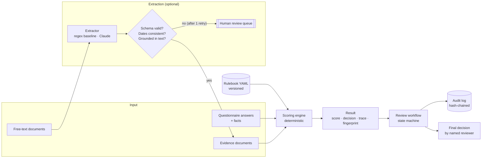

# evidence-review-engine

**Explainable due-diligence scoring for supply-chain participants.** Versioned rules, evidence that has to actually back each claim, a reviewer workflow with explicit states, a tamper-evident audit log, and an optional LLM step that is never trusted without validation.

[](https://github.com/karthikbhumireddy/evidence-review-engine/actions/workflows/ci.yml)

> [!IMPORTANT]
> **Everything here is synthetic and illustrative.** The rulebook, suppliers, documents and countries (`XA`–`XH`) are invented. The rulebook is not OECD, LBMA, RMI or any regulator's standard, nor any employer's methodology. A GO from this engine is a recommendation to a human reviewer, not a certification.

---

## The problem

Responsible-sourcing due diligence for gold and other minerals asks every refiner, trader and mine for the same thing: answers to a questionnaire plus documents that prove those answers. In practice:

- **Suppliers say "yes" to everything.** The risk sits in whether the evidence behind each "yes" is real, current and issued to *them*.
- **Scores are opaque.** A reviewer gets a number and can't see which answer or document moved it.
- **Overrides go undocumented.** Someone approves a flagged supplier, and six months later nobody can say who, or why.
- **AI is tempting and dangerous.** Extracting fields from licences and audit reports is tedious, so teams paste them into an LLM. A plausible but wrong licence number then flows silently into a compliance decision.

This engine is a working answer to those four problems. I built it after working on due-diligence products for responsible gold. It is a clean-room implementation: no employer code, data or rules.

## What it does: 60-second demo

```bash
git clone https://github.com/karthikbhumireddy/evidence-review-engine && cd evidence-review-engine
python -m venv .venv && . .venv/bin/activate      # Windows: .venv\Scripts\activate
pip install -e ".[dev]"
python -m evidence_review demo
```

Actual output:

```text
Rulebook illustrative-responsible-sourcing@1.0.0 (illustrative)

case                                     score  decision first reason
01-aurum-recyclers-go                      100  GO       score 100 meets GO threshold 75
02-sierra-traders-review                    73  REVIEW   score 73 below GO threshold 75
03-northfield-mining-nogo                   88  NO_GO    hard stop RF-SANCTIONS: An owner or director matches a sanctions list.
04-delta-refining-unsupported-claims        16  NO_GO    score 16 below review threshold 50
05-harbour-bullion-incomplete               90  REVIEW   incomplete: 3 item(s) unanswered

Workflow walk-through on the first case:
  #0 system           case_opened                  …
  #1 supplier-portal  state:draft->submitted       …
  #2 engine           state:submitted->scored      …
  #3 system           state:scored->in_review      …
  #4 reviewer.a       state:in_review->decided     …
  audit chain: intact
```

The five cases cover the decisions that matter:

| Case | What it shows |
|---|---|
| **Aurum** | Clean file → GO. `AURUM RECYCLERS LIMITED` on a licence still matches `Aurum Recyclers Ltd`. |
| **Sierra** | Expired export permit, missing environmental permit, and a conflict-affected origin. Caps at REVIEW, with every reason listed. |
| **Northfield** | Scores 88, but a sanctions match is a **hard stop**. No score buys it back, and no reviewer can approve it. |
| **Delta** | Answers "yes" to all 12 questions and scores **16**. Its documents belong to a different company, are expired, or are stale. |
| **Harbour** | Strong score, but sanctions status was never provided, so it cannot be GO. |

Full report for one case: `python -m evidence_review assess data/cases/02-sierra-traders-review.json`, or `--format json`.

## Features

| Implemented | Detail |
|---|---|
| **Versioned rulebook as data** | YAML: categories, weights, questions, required evidence, red flags, bands. Validated on load: weights must sum to 100, question points must equal their category weight, references must resolve. [`rulebooks/`](rulebooks/) |
| **Evidence-backed scoring** | A "yes" earns points only if every required document is present, unexpired, under 24 months old, and issued to the supplier's legal name (legal suffixes and case are normalised). |
| **Explicit red flags** | `hard_stop` → NO_GO regardless of score. `cap` → at best REVIEW. A missing fact that a flag depends on blocks GO. |
| **Explainability** | Per-question trace (answer, evidence status, points, reason), category subtotals, gap list, decision reasons. |
| **Reproducibility** | Every result carries a SHA-256 fingerprint of input plus rulebook version. Same input gives an identical result (tested). |
| **Reviewer workflow** | `draft → submitted → scored → in_review → decided`, plus "request information" back to draft. Illegal transitions raise errors. |
| **Governed overrides** | Disagreeing with the engine needs a written reason (≥20 chars). Hard stops can never be approved. Only the assigned reviewer can decide. |
| **Tamper-evident audit log** | Hash-chained, append-only. Editing, deleting or reordering any entry is detected by `verify()` (tested). |
| **Validated LLM extraction** *(optional)* | Claude proposes fields from free-text documents. The pipeline schema-validates them, checks dates are consistent, **grounds** every identifier against the source text, retries once with the errors as feedback, and otherwise routes to a human. Model refusals route to a human. |
| **Eval harness** | 20 labelled documents, including 6 traps where the right answer is "send to a human". The headline metric is **silent errors**. |

Not built: persistence, a web UI, authentication, multi-tenant rulebooks. See [Roadmap](#roadmap).

## Architecture



The boundary that matters: **nothing probabilistic sits inside the scoring path.** The LLM can only produce a candidate document, which must pass deterministic checks before the engine sees it. Detail in [docs/architecture.md](docs/architecture.md).

## Evaluation: does the LLM earn its place?

The regex baseline is the bar. Results are committed in [`evals/results/`](evals/results/), from a real run:

| Extractor | Silent errors | Correct accepts | Correct routes | Unnecessary routes | Cost |
|---|---:|---:|---:|---:|---:|
| `regex-baseline` | **0** | 8 / 14 | 6 / 6 | 6 | $0 |
| `claude-opus-5-5` | *not yet run* | | | | |

Reading this honestly:

- The baseline is **safe** (zero silent errors) but automates only **40%**: every prose document goes to a human.
- The 8 structured documents use labels the baseline was written for, so 8/8 is its best case, not a general claim.
- **The Claude row is empty because it has not been run.** It needs an API key and costs money (estimated well under $1 for 20 documents at current Opus 5.5 pricing, not yet measured). Run it with:

  ```bash
  pip install -e ".[llm]"
  export ANTHROPIC_API_KEY=...
  python evals/run_evals.py --extractor claude
  ```

  The LLM is worth adopting only if it converts the 6 unnecessary routes to correct accepts **and keeps silent errors at 0**. The grounding check is there to make that second condition hold.

## Technology decisions

| Choice | Why | Alternatives considered |
|---|---|---|
| Python 3.11+, Pydantic v2 | Validation at every boundary is the core idea, and Pydantic makes invalid states unrepresentable cheaply. | dataclasses + hand validation (more code, weaker errors) |
| Rules as YAML data, not code | Compliance teams change thresholds, and engineers shouldn't have to ship code for that. Versioned files diff cleanly in review. | A rules DSL or engine (overkill at this size) |
| Deterministic core, LLM at the edge | Decisions must be reproducible and explainable. [ADR-0001](docs/adr/0001-deterministic-core.md) | LLM scoring end-to-end (unexplainable, non-reproducible) |
| Grounding + retry + human route | Schema validity doesn't prove a value is true. [ADR-0002](docs/adr/0002-llm-extraction-behind-validation.md) | Trust structured output alone |
| Hash-chained log | Detects edits with ~40 lines of code and no infrastructure. [ADR-0003](docs/adr/0003-hash-chained-audit-log.md) | Database audit tables (need a DB), external ledger (overkill) |
| No web framework | The value is in the domain logic, and a CLI keeps the demo runnable in 60 seconds. | FastAPI service (planned, see roadmap) |

## Testing

```bash
python -m pytest --cov          # 59 tests
python -m ruff check src tests evals
python -m mypy                  # strict
python evals/run_evals.py       # baseline eval, regenerates evals/results/baseline.md
```

Last local run (Windows, Python 3.13): **59 passed**, **98% branch coverage** (`engine.py` 100%), ruff clean, mypy strict clean. CI runs the same on Ubuntu with Python 3.11 and 3.13.

What the tests pin down:

- Each sample case's exact score and decision.
- Every evidence status, plus boundaries: the expiry day itself, and the 730/731-day staleness edge.
- Hard stop beats a high score, and a cap beats a perfect score.
- Every illegal workflow transition, override-reason enforcement, the hard-stop approval block, and reviewer identity.
- Audit tampering by edit and by deletion.
- Extraction: retry with feedback, refusal, schema violation, transport failure, grounding failures, and cost arithmetic.
- The baseline's zero-silent-error property, as a regression gate.

The Claude adapter is excluded from coverage because CI has no key. Its code paths are exercised through a scripted fake that returns the same shapes.

## Security and limitations

- **Trust boundary:** case files and documents are untrusted input and are validated by Pydantic (`extra="forbid"`). Document text sent to the LLM is wrapped as data. The model's output is treated as untrusted and checked before use.
- **No secrets in the repo.** The only credential is `ANTHROPIC_API_KEY`, read by the SDK from the environment ([`.env.example`](.env.example)). CI scans for secrets with gitleaks.
- **Not tamper-*proof*.** Someone who can rewrite the whole log can rebuild the chain. Anchor the head hash externally for that.
- **Name matching is deliberately strict.** "Delta Refining Group" ≠ "Delta Precious Metals Trading" even if they're affiliates. That is a REVIEW for a human, not something to auto-resolve.
- **Grounding is lexical.** It proves an identifier appears in the text, not that it appears in the right role.
- **The rulebook is illustrative.** Real use needs a rulebook designed with compliance owners against the standard you're held to.

## Roadmap

1. Run the Claude eval and publish the numbers, whatever they are.
2. Add 20 more adversarial documents (two holders on one page, OCR noise, translated documents).
3. A thin FastAPI service plus SQLite persistence for cases and the audit log.
4. A rulebook diff tool: "what changes for every supplier if we move `go_min` from 75 to 80?"

## License

MIT. See [LICENSE](LICENSE). Built by [Karthik Bhumireddy](https://github.com/karthikbhumireddy) with Claude Code as an AI pair programmer. The problem comes from product work on responsible-gold due diligence. Every number in this README comes from a real run of the code in this repository.
