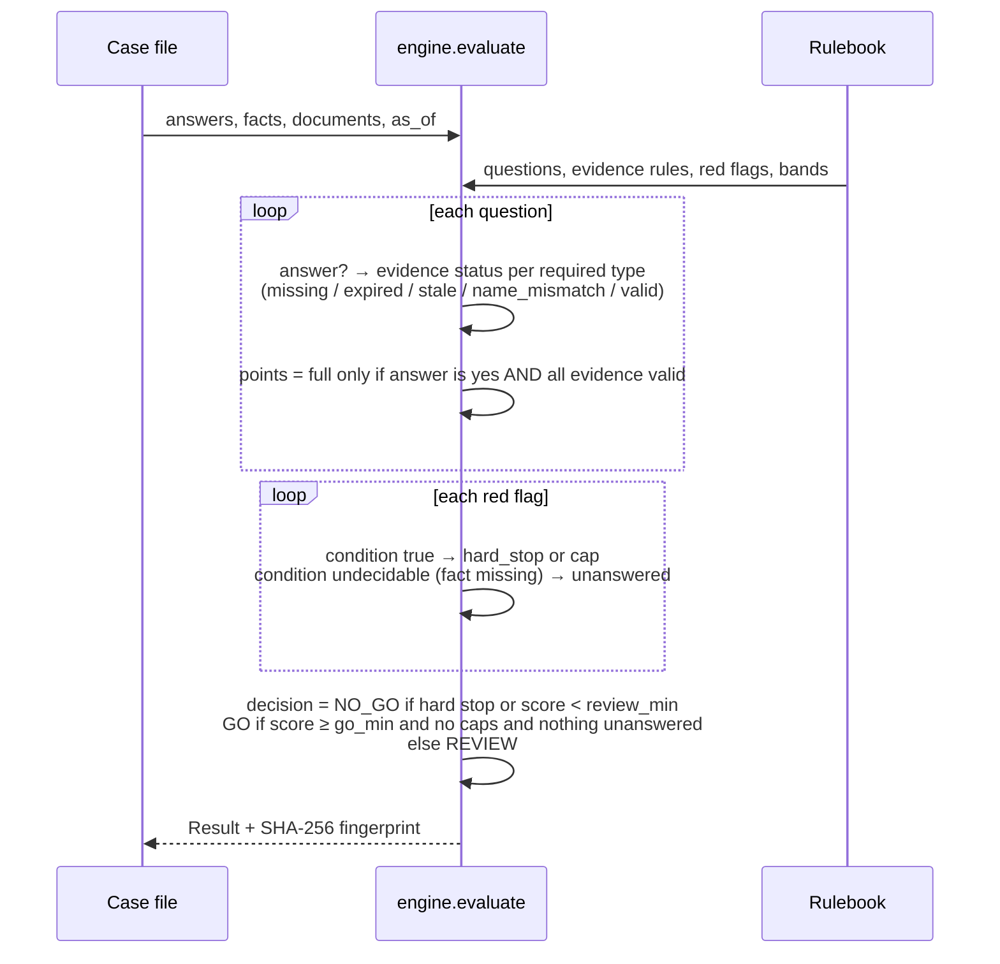
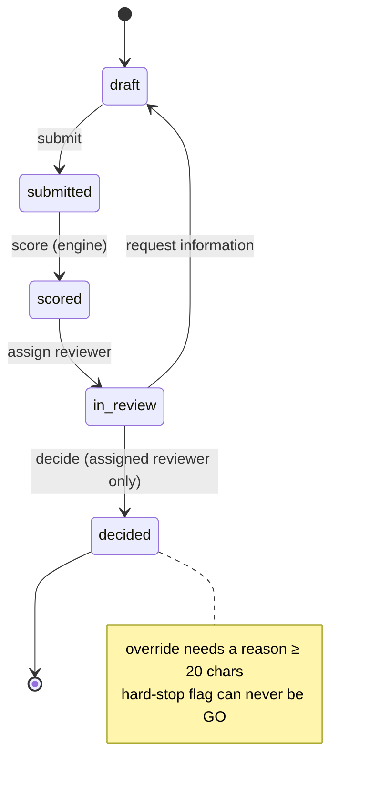
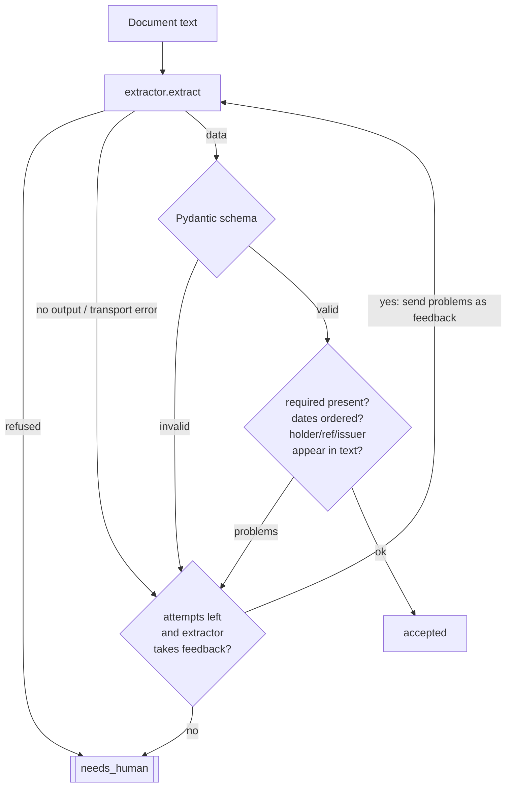

# Architecture

## Modules

| Module | Responsibility | Depends on |
|---|---|---|
| `models.py` | Pydantic types for rulebook, case input and result. Rulebook self-consistency checks. | — |
| `rulebook.py` | Load and validate YAML. Wrap errors in `RulebookError`. | models |
| `engine.py` | Pure function `evaluate(assessment, rulebook) -> Result`. No I/O, no clock, no randomness. | models |
| `workflow.py` | `ReviewCase` state machine. Governance rules on decisions. | engine, audit |
| `audit.py` | Hash-chained append-only log, `verify()`, JSONL round-trip. | — |
| `extraction/` | `Extractor` protocol, regex baseline, Claude adapter, pipeline (validate → ground → retry → route). | models, engine.normalise_name |
| `report.py` / `cli.py` | Markdown and JSON output. `assess`, `demo`, `extract` commands. | all |

## Scoring sequence

## Review state machine

## Extraction pipeline

Every attempt records latency, input and output tokens, and USD cost. `evals/run_evals.py` aggregates these.

## Invariants (each one tested)

1. `evaluate` is deterministic. Equal inputs give equal `Result` and fingerprint.
2. Category weights sum to 100, and each category's question points equal its weight.
3. A `hard_stop` red flag always yields NO_GO, and the workflow refuses GO for it.
4. Nothing reaches `decided` without passing through `scored` and `in_review`.
5. Any modification of a past audit entry makes `verify()` non-empty.
6. An extractor result is `accepted` only when schema, consistency and grounding checks all pass.
